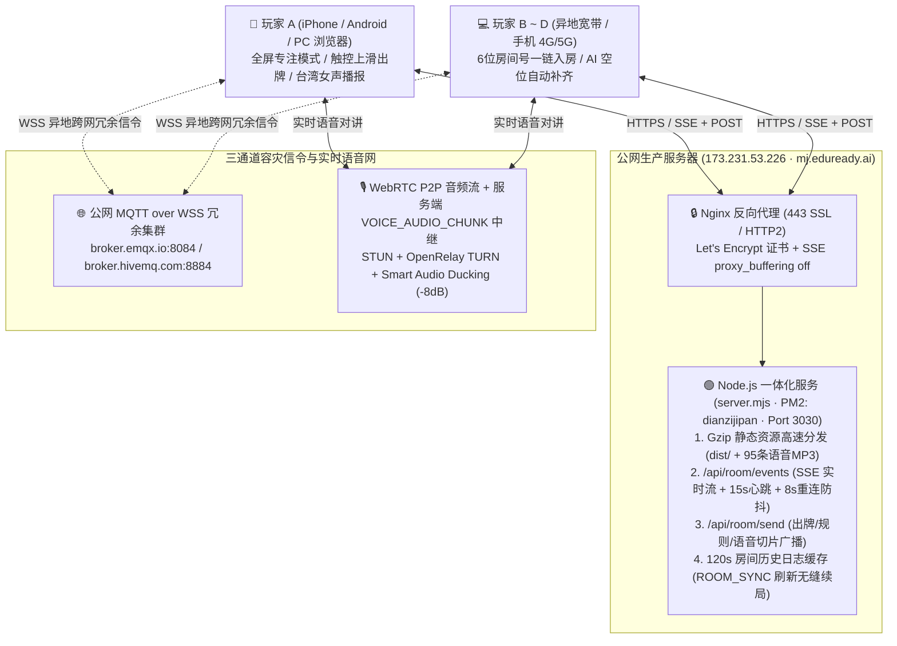

# 《电子基盘》(Electron Base) 街机 1:1 复刻 & 公网 2P/4P 联机版
# 项目全景架构与生产运维交接手册 (HANDOFF.md)

**更新时间**：2026-11-16 23:52 (Local Time)  
**当前版本**：**Release `v3.5.2`（全链路 8 大防卡死深度加固：鸣牌阶段点击手牌直接摸牌、DRAW/DISCARD 乱序自愈、胡牌结果强同步、SSE 断流自愈 + HTTP POST 捎带双保险、台湾女声全配音与腾讯棋牌设定版）**  
**线上生产域名**：[`https://mj.eduready.ai`](https://mj.eduready.ai)（服务器：`173.231.53.226`）  
**GitHub 仓库**：[`https://github.com/EidenLiose/dianzijipan`](https://github.com/EidenLiose/dianzijipan)

---

## 📌 当前运行摘要 (Executive Summary)

1. **原版《电子基盘》1:1 像素级（640×480）引擎与音画完整复刻**：
   - 完整移植 [`weimzh/mahjong`](https://github.com/weimzh/mahjong) C++ 核心状态机（`CTile`、`CHand`、`CBasePlayer`、`CPlayer`、`CBot`、`CGame`、`CGeneral`）至 TypeScript + HTML5 Canvas。
   - 100% 还原日本立直麻将 / 电子基盘全役种与符数/番数结算（含天和、地和、人和、大三元、大四喜、国士无双、九莲宝灯、四暗刻、清一色、七对子、三元特快、配牌出血时钟游戏、立直必胡、海底捞月等原版街机彩蛋）。
2. **台湾麻将甜美女声全套真人级配音（95 条独立 `.mp3` 语音包，`zh-TW-HsiaoChenNeural`）**：
   - **34 种麻将牌面打牌实时报牌**（`public/weimzh/voice/tiles/*.mp3`）：每打出一张牌自动播报正宗台湾女声（`一萬`~`九萬`、`一筒`~`九筒`、`一條`~`九條`、`東風`/`南風`/`西風`/`北風`、`紅中`/`發財`/`白板`）。
   - **7 种吃/碰/杠/听/胡动作娇嗔播报**（`public/weimzh/voice/actions/*.mp3`）：触发动作时实时喊出 `「吃！」`、`「碰！」`、`「槓！」`、`「聽牌啦！」`、`「自摸啦！」`、`「胡啦！」`、`「換牌！」`。
   - **46 种胡牌牌型（番种）结算顺序唱番**（`public/weimzh/voice/yaku/*.mp3` + [player.ts](file:///C:/Users/viply/cowork/my-mahjong-project/src/weimzh/player.ts) `AnnounceResultVoice()`）：胡牌进入结算界面时，按照实际达成的役种从上到下逐一唱出牌型名称及满贯/跳满/倍满/役满等级。
3. **腾讯《欢乐麻将》标准倒计时、AI 自动托管 & 8 句经典快捷语音**：
   - **本机出牌思考 30s / 鸣牌响应 15s / 等待远程对手 45s / 断线重连保护 60s**：超时未操作自动开启电脑 AI 托管代打并同步给全房，绝不卡死牌局。
   - **主动电脑托管开关**：顶部栏、右侧动作面板、全屏/手机悬浮胶囊常驻 `🤖 电脑托管 / 取消托管` 按钮；联机战况面板常驻 `🤖 立即由 AI 接管对手` 按钮。
   - **8 句腾讯棋牌经典快捷语音**（`public/weimzh/voice/taunts/taunt_0~7.mp3`）：预生成独立 MP3 音频（*「快点吧，我等的花儿都谢了！」*、*「不要走，决战到天亮！」* 等），跨平台 100% 响亮播放。
4. **公网三通道跨网联机（默认 2P 死斗 + 可选 4P 环桌）与高可靠帧同步**：
   - **三通道并发行信令**：同域 SSE（`/api/room/events` + `/api/room/send`）+ 公网 MQTT over WSS（`broker.emqx.io` / `broker.hivemq.com`）+ 同机 `BroadcastChannel`，`msgId` 幂等去重。
   - **跨局帧同步防死锁**：统一赢家与输家胡牌结算动画时长，移除跨局 `clearMoveQueue()`，为每个 `DRAW` / `DISCARD` 包附加 `round: pvpRoundCounter` 局数标签与 `tileCode` 牌面强校验，彻底解决第 2 局「两边等待出牌但无牌可打」死锁。
   - **SSE 8 秒重连宽限期（Grace Period）**：[server.mjs](file:///C:/Users/viply/cowork/my-mahjong-project/server.mjs) 对 `/api/room/events` 瞬断设置 8 秒防抖缓冲，彻底消除移动网络/代理毫秒级自动重连触发的虚假「对手断线」横幅。
   - **WebRTC P2P 实时语音 + `MediaRecorder` 服务端语音切片中继双保险**：支持进房实时通话、BGM 智能音频闪避（`-8dB`）以及 `🎤 点击发送 3 秒真人麦克风语音` 跨网必达对讲。

---

## 目录
1. [系统全局架构与网络拓扑](#1-系统全局架构与网络拓扑)
2. [开发与生产环境节点矩阵](#2-开发与生产环境节点矩阵)
3. [核心模块职责与关键文件索引](#3-核心模块职责与关键文件索引)
4. [版本演进与重大技术问题复盘 (v1.0.0 ~ v3.5.0)](#4-版本演进与重大技术问题复盘-v100--v350)
5. [日常开发、构建推送与线上运维 SOP](#5-日常开发构建推送与线上运维-sop)
6. [后续扩展与迭代建议队列](#6-后续扩展与迭代建议队列)

---

## 1. 系统全局架构与网络拓扑



---

## 2. 开发与生产环境节点矩阵

| 环境标识 | 位置 / 访问地址 | 守护进程 / 端口 | 仓库与密钥配置 | 核心职责 |
| :--- | :--- | :--- | :--- | :--- |
| **本地开发工作站** | Windows 11<br>项目路径：`C:\Users\viply\cowork\my-mahjong-project`<br>软链路径：`c:\Users\viply\cowork\1113-iphone\my-mahjong-project` | Vite Dev Server: `http://localhost:3000` | Git Remote: `git@github.com:EidenLiose/dianzijipan.git`<br>专用 SSH Key: `~/.ssh/id_ed25519_eidenliose` | 源码开发、TypeScript 类型检查（`vue-tsc`）、语音包生成与 GitHub 推送 |
| **GitHub 代码仓库** | [`https://github.com/EidenLiose/dianzijipan`](https://github.com/EidenLiose/dianzijipan) | 分支：`main` | 部署公钥已绑定仓库 Deploy Keys（含读写权限） | 源码、原版音画资源、95 条台湾女声 MP3、部署脚本与文档版本控制 |
| **线上生产服务器** | `173.231.53.226`<br>`ssh root@173.231.53.226`<br>目录：`/data/www/mj.eduready.ai` | • PM2 进程名：`dianzijipan`<br>• 内部端口：`127.0.0.1:3030`<br>• Nginx 公网：`https://mj.eduready.ai` (80/443) | Nginx 配置：`/etc/nginx/conf.d/mj.eduready.ai.conf`<br>SSL 证书：`/etc/letsencrypt/live/mj.eduready.ai/` | 公网玩家直连、HTTPS 麦克风权限解锁、同域 SSE 毫秒级信令与房间断点续局 |

---

## 3. 核心模块职责与关键文件索引

| 文件路径 | 核心职责说明 |
| :--- | :--- |
| [server.mjs](file:///C:/Users/viply/cowork/my-mahjong-project/server.mjs) | 零依赖 Node.js 生产服务端：静态资源 `gzip` 压缩分发、`/api/room/events` SSE 房间流（15s 心跳 + **8s 断线重连防抖 `leaveTimer`**）、`/api/room/send` 广播、房间对局快照与 `moves` 队列缓存（支持玩家刷新网页 `ROOM_SYNC` 无缝续局）。 |
| [src/App.vue](file:///C:/Users/viply/cowork/my-mahjong-project/src/App.vue) | 豪华街机框体 UI、**`⛶ 全屏专注模式`**、**`🤖 电脑托管` 开关**、出牌倒计时胶囊、固定昵称编辑器、公网 2P/4P 联机大厅、8 句腾讯棋牌经典快捷语音、3 秒真人麦克风语音录制按钮、触控手势层（单击/双击/上滑 `>30px` 出牌）。 |
| [src/weimzh/player.ts](file:///C:/Users/viply/cowork/my-mahjong-project/src/weimzh/player.ts) | 麻将核心引擎（`CBasePlayer` / `CPlayer` / `CBot` / `CGame`）：1v1 二人街机死斗（`NewRound` / `PlayRound`）与 4P 四人环桌麻将（`NewRound4P` / `DrawTable4P` / `PlayRound4P`）、腾讯棋牌倒计时（30s/15s/45s）、AI 智能选牌评估函数（`pickBestDiscardIndex`）、胡牌结算台湾女声逐一唱番（`AnnounceResultVoice`）、单机 `localStorage` 断点快照与联机防作弊管控。 |
| [src/weimzh/pvpManager.ts](file:///C:/Users/viply/cowork/my-mahjong-project/src/weimzh/pvpManager.ts) | 三通道联机管理器（`PvpManager` + `PublicWssSignaling`）：固定玩家身份持久化（`weimzh_pvp_identity_v1`）、`pvpRoundCounter` 局数校验与 `tileCode` 同步、WebRTC P2P 音频网格（STUN + OpenRelay TURN）、`MediaRecorder` 3 秒真人语音切片收发（`VOICE_AUDIO_CHUNK`）、腾讯快捷语音 MP3 播报。 |
| [src/weimzh/general.ts](file:///C:/Users/viply/cowork/my-mahjong-project/src/weimzh/general.ts) | 640×480 Canvas 渲染管线：22 张原版位图 `Promise.all` 并发预加载与启动进度条、非阻塞字体加载、原版 `.ogg` BGM 与 `.wav` 音效播放、台湾女声报牌/动作/唱番播放器（`PlayTileVoice` / `PlayActionVoice` / `PlayYakuVoice`）、BGM 智能音频闪避（Smart Audio Ducking `-8dB`）。 |
| [src/weimzh/hand.ts](file:///C:/Users/viply/cowork/my-mahjong-project/src/weimzh/hand.ts) | 手牌数据结构、吃/碰/杠/暗杠/加杠判定、听牌（`IsReady`）与和牌（`CanMahjong` / `GoMahjong`）面子拆解算法。 |
| [src/weimzh/tile.ts](file:///C:/Users/viply/cowork/my-mahjong-project/src/weimzh/tile.ts) | 34 种麻将牌编码（`1C~9C`、`1D~9D`、`1B~9B`、`EW/SW/WW/NW`、`RD/GD/WD`）、136 张牌山发牌与余牌统计。 |
| [src/weimzh/titles.ts](file:///C:/Users/viply/cowork/my-mahjong-project/src/weimzh/titles.ts) | 役种番数中英日文本表、Mulberry32 确定性随机数发生器（`setGameSeed` / `RandomLong`），保障联机全员牌山 100% 一致。 |
| [deploy-server.sh](file:///C:/Users/viply/cowork/my-mahjong-project/deploy-server.sh) | 生产服务器一键构建与 PM2 重启脚本。 |
| [nginx-mj.eduready.ai.conf](file:///C:/Users/viply/cowork/my-mahjong-project/nginx-mj.eduready.ai.conf) | 生产服务器 Nginx SSL + SSE 反代配置文件模板。 |

---

## 4. 版本演进与重大技术问题复盘 (`v1.0.0` ~ `v3.5.2`)

| 版本号 | 关键里程碑与根因修复复盘 |
| :--- | :--- |
| **`v3.5.2`** *(当前)* | 1. **鸣牌阶段点击手牌 `A~M` 直接跳过并摸牌 + 循环外绝对倒计时**：解决玩家在可吃/可碰（手里 13 张牌）时点击手牌 `A~M` 被忽略且不断重置 15s 倒计时导致「无牌可打」的交互死锁。<br>2. **`DRAW` / `DISCARD` 阶段强校验与乱序/丢包自愈（`prevDraw`）**：每个 `DISCARD` 包附带前序 `prevDraw` 快照；若 `DISCARD` 先于 `DRAW` 到达或 `DRAW` 丢失，自动合成 `DRAW` 动作并保留 `DISCARD`，彻底杜绝阶段错位。<br>3. **`PlayRound` 流局 `PA_NONE` 外层跳出修复**：修复 `act === PA_NONE` 仅 `break` 内层循环而误入 `AS_DISCARD` 的移植 Bug。<br>4. **胡牌手牌与结果（`winHand` + `winResult`）随包强同步**：确保双端番种、分数、唱番语音时长 100% 一致。<br>5. **立直（`PA_REACH`）自动优选有效听牌张 & `abortWaitingMove()` 0ms 立即接管**。<br>6. **Cloudflare SSE 断流自愈 + `POST /api/room/send` 捎带最近 25 条事件双保险 + 20 巡流局广播与终局 3.5s 自动续局**。 |
| **`v3.5.0`** | 1. **台湾甜美女声 95 条配音包**：覆盖 34 张牌面报牌、7 种动作（吃/碰/杠/听/自摸/胡/换牌）、46 种胡牌牌型结算逐一唱番。<br>2. **对齐腾讯《欢乐麻将》设定**：本机出牌 30s、鸣牌 15s、对手等待 45s、重连 60s；替换 8 句腾讯棋牌经典快捷语音 MP3。<br>3. **修复联机第 2 局「两边等待出牌但无牌可打」死锁**：统一赢家/输家胡牌动画时长，移除 `NewRound()` 中误删对方新局 `DRAW` 包的 `clearMoveQueue()`，增加 `round` 局数标签与 `tileCode` 牌面强校验，修复副露后 `N` 键槽位索引偏移。<br>4. **修复频繁误报「对手断线」**：`server.mjs` 增加 8 秒 SSE 重连宽限期（`leaveTimer`），过滤移动网络毫秒级闪断。 |
| **`v3.4.0`** | 新增全局常驻 **「🤖 电脑托管」** 按钮與 **「立即由 AI 接管对手」** 按钮；实装出牌倒计时防挂机死锁；新增 OpenRelay TURN 节点与 `MediaRecorder` 3 秒真人语音切片服务端中继（`VOICE_AUDIO_CHUNK`），解决跨网麦克风与快捷语音无声问题。 |
| **`v3.3.0`** | 默认对局模式设为 **2P 二人街机死斗**；新增联机弹窗内嵌昵称修改栏；新增 **「⛶ 全屏专注模式」**（隐藏外围面板，100% 聚焦牌桌）与手机端自适应布局减负；补齐开局换牌「✅ 确认完成」与鸣牌「⏭️ 跳过/摸牌」触控气泡。 |
| **`v3.2.0`** | 修复每次刷新昵称后缀随机变化问题（`localStorage` 持久化身份）；实现单机快照自动恢复与联网 `ROOM_SYNC` 服务端房间日志重放续局；字体异步加载 + 22 张位图 `Promise.all` 并发预加载 + 服务端 `gzip` 解决公网首屏黑屏。 |
| **`v3.1.0`** | 编写零依赖生产服务端 `server.mjs` 与 Nginx SSL 反代配置，完成 `https://mj.eduready.ai`（`173.231.53.226`）公网部署与 Let's Encrypt HTTPS 证书签发。 |
| **`v3.0.0`** | 新增免服公网 MQTT over WSS 跨网直连、**4P 四人环桌麻将引擎**（支持 `1~4 真人 + AI 自动补齐`、四向牌河与中央罗盘）、以及联网防作弊锁定（屏蔽单机随机彩蛋與改牌秘技）。 |
| **`v2.0.0`** | 实现掼蛋级「一链入房」1v1 联机、Mulberry32 确定性种子同步、WebRTC P2P 语音与 BGM 智能闪避（`-8dB`）、触控上滑 `>30px` 出牌手势。 |
| **`v1.0.0`** | 完成 `weimzh/mahjong` C++ 源码与原版音画、字体资源的 1:1 像素级 HTML5 Canvas 移植。 |

---

## 5. 日常开发、构建推送与线上运维 SOP

### 5.1 本地开发与构建验证
```powershell
Set-Location "C:\Users\viply\cowork\my-mahjong-project"

# 启动本地开发服 (http://localhost:3000)
npm run dev

# 执行 TypeScript 类型检查与生产打包
npm run build
```

### 5.2 全量推送到 GitHub
```powershell
Set-Location "C:\Users\viply\cowork\my-mahjong-project"
git add -A
git commit -m "feat(vX.Y.Z): 描述本次迭代功能"
git push origin main
```

### 5.3 一键部署更新至生产服务器 (`mj.eduready.ai` / `173.231.53.226`)
```powershell
ssh root@173.231.53.226 "cd /data/www/mj.eduready.ai && git pull origin main && npm run build && pm2 restart dianzijipan"
```

### 5.4 线上服务巡检与日志排查命令
```bash
# 查看 PM2 中 dianzijipan 进程状态与内存占用
ssh root@173.231.53.226 "pm2 status dianzijipan"

# 查看实时服务端房间与信令日志
ssh root@173.231.53.226 "pm2 logs dianzijipan --lines 50"

# 验证线上静态资源、房间 API 与台湾女声 MP3 连通性
curl -I https://mj.eduready.ai/
curl -s https://mj.eduready.ai/api/room/info
curl -I https://mj.eduready.ai/weimzh/voice/tiles/1C.mp3
```

### 5.5 重新生成或扩展台湾女声配音包
配音生成脚本位于 `C:\Users\viply\.gemini\antigravity\brain\3c20e3ad-991d-41b5-a99c-8897d42c2214\scratch\generate_tw_voices.py`（使用 `edge-tts` 的 `zh-TW-HsiaoChenNeural` 模型），生成的音频保存在 `public/weimzh/voice/{tiles,actions,yaku,taunts}/` 目录下。

---

## 6. 后续扩展与迭代建议队列

1. **战绩排行榜与历史牌谱回放**：
   - 在 `server.mjs` 中将每局结算番种与筹码变动持久化到本地 JSON/SQLite，在联机大厅展示「今日雀神胜率榜」与最近 10 局番种战报。
2. **台湾十六张麻将规则可选开关**：
   - 当前规则为《电子基盘》原版 13 张日本立直麻将规则 + 台湾女声报牌唱番；后续如有需要可在建房面板增加「十三张电子基盘 / 台湾十六张（含花牌春夏秋冬梅兰竹菊）」规则切换。
3. **微信/手机浏览器横屏锁定引导**：
   - 在手机竖屏全屏模式下，可增加一键横屏旋转适配（CSS `@media (orientation: portrait)` 旋转画布选项），让手机横握时牌面尺寸再放大 60%。
